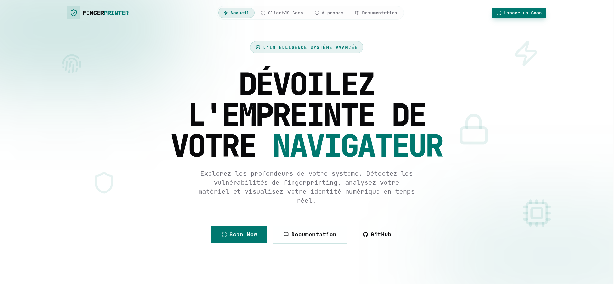

<div align="center">


# Device Intelligence

*Comprehensive browser fingerprinting, system forensics, and privacy audit platform.*

[](https://nextjs.org/)
[](https://react.dev/)
[](https://www.typescriptlang.org/)
[](https://tailwindcss.com/)
[](https://serwist.pages.dev/)
[](https://next-intl-docs.vercel.app/)

[Overview](#overview) • [Key Features](#key-features) • [Preview](#preview) • [Tech Stack](#tech-stack) • [Getting Started](#getting-started) • [Environment Variables](#environment-variables) • [Project Structure](#project-structure) • [Privacy & Security](#privacy--security)

</div>

---

> [!NOTE]
> Device Intelligence is an educational and diagnostic platform designed to uncover what browsers and devices broadcast during normal web browsing. All analysis runs directly on the client side without storing personal tracking data.

## Overview

**Device Intelligence** is a modern, full-stack browser forensics and device audit web application built with **Next.js 16 (App Router)** and **React 19**. It provides users, security auditors, and developers with transparent insight into browser identification vectors, system-level metadata, hardware capabilities, and network geolocation.

The platform bridges client-side heuristic inspection with modern verification tools, offering both an in-depth **ClientJS Forensic Scanner** and a live **Fingerprint Pro SDK Playground**. Results can be reviewed through an intuitive glassmorphic interface, inspected as raw telemetry, and exported into multiple reporting formats.

## Key Features

- **Deep System Forensics**: Identifies operating system name, kernel version, architecture, CPU profile, device vendor, and hardware type.
- **Hardware & Display Diagnostics**: Extracts screen dimensions, available viewport, color depth, pixel density (XDPI / YDPI), and hardware canvas fingerprints.
- **Browser Capability Audit**: Inspects user agent signatures, rendering engines, plugin registries, MIME types, system font availability, and storage APIs (Cookies, LocalStorage, SessionStorage).
- **Network Intelligence & Interactive Map**: Resolves public IP details (IPv4/IPv6), ASN, ISP, city, postal code, and country boundaries with live geospatial mapping powered by **Leaflet**.
- **Fingerprint Pro SDK Testing**: Dedicated sandbox to test `@fingerprint/react` visitor identification, event IDs, confidence metrics, latency, and regional endpoints (`US`, `EU`, `AP`).
- **Multi-Format Export & Sharing**: Export complete forensic scans in one click as **JSON**, **Markdown**, **plain text**, **printable PDF** (via jsPDF), or **PNG/JPEG images** (via html2canvas).
- **Progressive Web App (PWA)**: Offline-ready, installable on desktop and mobile devices with background service workers managed by **Serwist**.
- **Multilingual Support (i18n)**: Fully internationalized across English, French, and Spanish with localized route matching powered by **next-intl**.
- **Modern Adaptive UI**: Responsive glassmorphic interface supporting dark and light modes via **next-themes** and styled with **Tailwind CSS 4** and **shadcn/ui**.

## Preview

<div align="center">
  
</div>

## Tech Stack

| Layer | Technologies |
| :--- | :--- |
| **Framework & Runtime** | [Next.js 16](https://nextjs.org/) (Turbopack, App Router), [React 19](https://react.dev/), [TypeScript 5.9](https://www.typescriptlang.org/) |
| **Styling & Components** | [Tailwind CSS 4](https://tailwindcss.com/), [shadcn/ui](https://ui.shadcn.com/), [Radix UI](https://www.radix-ui.com/), [Base UI](https://base-ui.com/) |
| **Animation & UX** | [Motion](https://motion.dev/), [next-themes](https://github.com/pacocoursey/next-themes), [Sonner](https://sonner.emilkowal.ski/) |
| **Forensics & Fingerprinting** | [ClientJS](https://clientjs.org/), [@fingerprint/react](https://dev.fingerprint.com/docs/fingerprintjs-pro-react) |
| **Mapping & Geolocation** | [Leaflet](https://leafletjs.com/), [React-Leaflet](https://react-leaflet.js.org/), [ipapi.co](https://ipapi.co/) |
| **Reporting & Export** | [jsPDF](https://parall.ax/products/jspdf), [html2canvas](https://html2canvas.hertzen.com/) |
| **PWA & Offline** | [Serwist / Next](https://serwist.pages.dev/) |
| **Internationalization** | [next-intl](https://next-intl-docs.vercel.app/) (en, fr, es) |

## Getting Started

### Prerequisites

- [Node.js](https://nodejs.org/) (v20.x or higher recommended)
- [pnpm](https://pnpm.io/) (Recommended) or `npm` / `yarn` / `bun`

### Installation

1. **Clone the repository:**

   ```bash
   git clone https://github.com/fapethedev/device-intelligence.git
   cd device-intelligence
   ```

2. **Install project dependencies:**

   ```bash
   pnpm install
   ```

3. **Set up environment variables:**

   ```bash
   cp .env.example .env.local
   # or configure your existing .env file
   ```

4. **Launch the development server:**

   ```bash
   pnpm dev
   ```

   Visit [http://localhost:3000](http://localhost:3000) in your browser to explore the dashboard.

### Available Scripts

| Command | Description |
| :--- | :--- |
| `pnpm dev` | Starts the development server with Next.js Turbopack |
| `pnpm build` | Compiles and builds the production application with Serwist service worker |
| `pnpm start` | Runs the compiled production server |
| `pnpm lint` | Executes ESLint to check code quality and conventions |
| `pnpm format` | Formats TypeScript and TSX source files with Prettier |
| `pnpm typecheck` | Validates TypeScript types across the codebase without emitting artifacts |

## Environment Variables

Configure the following variables in your `.env` or `.env.local` file:

```env
# Public domain URL for canonical links and OpenGraph metadata
NEXT_PUBLIC_SERVER_URL=https://di.fapethedev.com/

# Optional Google Analytics / Tag Manager container ID
NEXT_PUBLIC_GOOGLE_ANALYTICS_ID=GTM-XXXXXXX

# Suppress Turbopack compatibility notices for Serwist in development
SERWIST_SUPPRESS_TURBOPACK_WARNING=1
```

> [!TIP]
> To test the **Fingerprint Pro** identification module, you can enter any valid public API key directly within the interactive tester UI at `/fingerprint` without needing to hardcode secrets in environment files.

## Project Structure

```text
├── messages/               # Localization dictionaries (en, fr, es)
├── public/                 # Static assets, PWA icons, screenshots
└── src/
    ├── app/                # Next.js App Router root
    │   ├── [locale]/       # Localized route handler
    │   │   ├── about/      # Mission, history, and developer page
    │   │   ├── fingerprint/# Fingerprint Pro SDK testing playground
    │   │   ├── scanner/    # ClientJS forensic scan dashboard
    │   │   └── page.tsx    # Home landing page
    │   ├── manifest.ts     # Web App Manifest definition
    │   ├── robots.ts       # Search engine crawler policies
    │   ├── sitemap.ts      # Automated multilingual sitemap generator
    │   └── sw.ts           # Serwist service worker lifecycle
    ├── components/         # Reusable React components
    │   ├── about/          # About section widgets and timelines
    │   ├── explorer/       # Forensic scanner grid, headers, cards, export utilities
    │   ├── fingerprint/    # Fingerprint SDK interactive tester
    │   ├── layout/         # Navigation bar, mobile drawer, and footer
    │   └── ui/             # shadcn/ui and Radix UI primitive design system
    ├── hooks/              # Custom hooks (PWA install prompt, mobile detection)
    ├── i18n/               # next-intl routing definitions and navigation helpers
    └── lib/                # Shared utilities and tracking helpers
```

## Privacy & Security

> [!IMPORTANT]
> **Educational & Diagnostic Scope**  
> This application is created strictly for educational, security auditing, and forensic diagnostic research. It illustrates how readily identifiable browser characteristics and network signatures can be. Device Intelligence does not sell, persist, or profile personal data on remote databases. All heuristic extractions take place in the visitor's local execution context.
